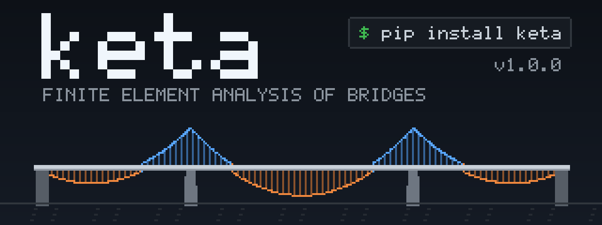

<p align="center"></p>

# keta

Noyau de calcul par éléments finis pour les structures à barres et les ouvrages d'art, écrit en
C++20 et piloté depuis Python.

*Finite-element kernel for bar structures and bridges, written in C++20 and driven from Python.*

## Installation

```sh
pip install keta
```

Depuis les sources (compilateur C++20 et CMake 3.20 ou plus) : `pip install .`

### Interface graphique (Windows)

keta graphique est l'interface graphique de keta : on y décrit un modèle, on lance les calculs du
noyau et on en lit les résultats à l'écran, ou on décrit la structure par un graphe paramétrique.
Elle est fournie pour Windows 10 et 11 (64 bits) sous forme portable, sans installation, par
l'archive `dist/keta_graphique-0.9.0-windows-x64.zip` : la décompresser, puis lancer
`keta_graphique.bat`. Son manuel, `docs/keta_graphique_manuel.pdf`, figure aussi dans l'archive.
L'application n'est pas signée : Windows SmartScreen peut demander une confirmation
(« Informations complémentaires », puis « Exécuter quand même »).

## Exemple

```python
import keta

m = keta.Model()
a, b = m.add_node(0, 0, 0), m.add_node(10, 0, 0)
poutre = m.add_beam(a, b, m.add_section("IPE400"), m.steel())
m.add_support(a, dx=True, dy=True, dz=True, rx=True, rz=True)
m.add_support(b, dy=True, dz=True, rz=True)
m.add_udl(poutre, wz=-20e3)                      # 20 kN/m

cas = m.analyze().case(1)
print(cas.bar_forces(poutre)[5])                 # efforts à mi-portée
print(cas.displacement(b))                       # (dx, dy, dz, rx, ry, rz)
```

## Documentation

| | Français | English |
|---|---|---|
| Manuel d'utilisation de l'API Python / Python API user manual | `docs/keta_manuel_python.pdf` | `docs/keta_python_manual.pdf` |
| Principes de calcul / Calculation principles | `docs/keta_principes_de_calcul.pdf` | `docs/keta_calculation_principles.pdf` |
| Manuel de l'interface graphique / Graphical interface manual | `docs/keta_graphique_manuel.pdf` | — |

Les exemples des manuels, avec leurs sorties, sont dans `examples/manuel` et `examples/manual`.
Les mêmes documents existent en HTML dans `site/`, en texte intégral dans `llms-full.txt` (index :
`llms.txt`), et sont accessibles par un serveur MCP de documentation (`pip install "keta[mcp]"`, puis `keta-mcp`).

## Avertissement

keta est un outil d'aide au calcul. Il est fourni « tel quel », sans garantie d'aucune sorte,
expresse ou implicite, notamment d'exactitude des résultats ou d'adéquation à un usage particulier.
Les résultats ne dispensent pas d'un contrôle par un ingénieur qualifié : ils doivent être vérifiés
par un calcul indépendant avant toute utilisation dans une étude, une justification ou une
construction. L'auteur ne saurait être tenu responsable d'un dommage résultant de l'utilisation du
logiciel ou de ses résultats.

## Licence

MIT, voir [`LICENSE`](LICENSE).
